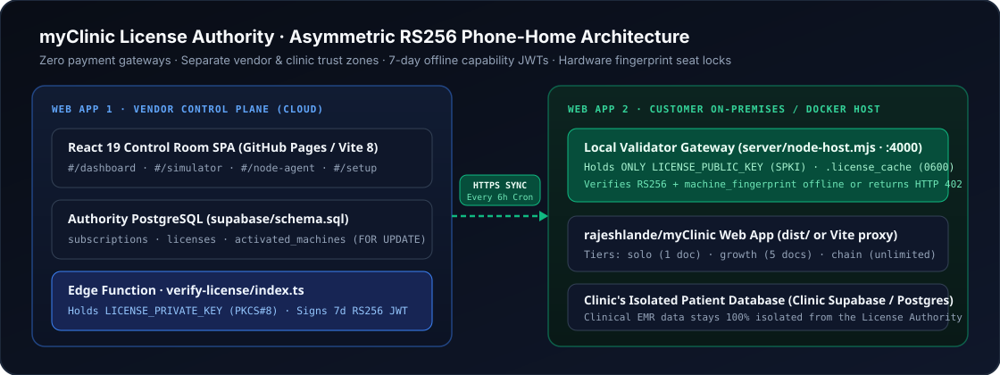

<div align="center">


# myClinic License Authority

**Centralized Manual Subscription Management & Asymmetric RS256 Phone-Home Validation Engine for Self-Hosted [`myClinic`](https://github.com/rajeshlande/myClinic.git) Deployments**

[](LICENSE)
[](.nvmrc)
[](package.json)
[](vite.config.js)
[](docs/SECURITY.md)
[](tests/)
[](.github/workflows/pages.yml)

[Quick Start](#installation) · [Connect with `myClinic`](#step-by-step-connecting-both-web-apps) · [API Reference](#local-validator-api-reference) · [Security Policy](SECURITY.md) · [Contributing](CONTRIBUTING.md)

</div>

---

**myClinic License Authority** solves subscription enforcement for distributed, clinic-hosted software **without third-party payment gateways** (such as Stripe or Razorpay). Operators record bank/UPI/PO payments manually in a vendor-hosted Control Room, issue 32-character cryptographic license keys, cap hardware seats, and revoke access remotely. Customer-hosted [`rajeshlande/myClinic`](https://github.com/rajeshlande/myClinic.git) installations phone home every 6 hours for a short-lived **7-day RS256 capability JWT**, continue operating offline during internet outages, and enforce **`HTTP 402 Payment Required`** automatically using only an asymmetric **public key** — ensuring even root container access cannot forge or extend a subscription.



---

## Table of Contents

- [Features](#features)
- [Technologies Used](#technologies-used)
- [Prerequisites](#prerequisites)
- [Installation](#installation)
- [Usage](#usage)
- [Step-by-Step: Connecting Both Web Apps](#step-by-step-connecting-both-web-apps)
- [Environment Variables](#environment-variables)
- [Local Validator API Reference](#local-validator-api-reference)
- [Testing & Security Audits](#testing--security-audits)
- [Deployment (GitHub Pages & Docker)](#deployment-github-pages--docker)
- [Project Structure](#project-structure)
- [Contributing](#contributing)
- [Security](#security)
- [License](#license)

---

## Features

- **Manual Subscription & Entitlement Control Room (`#/dashboard`):** Provision customer subscriptions atomically, track PO/UTR references with XSS-safe rich formatting, monitor active vs. expiring seats, inspect registered hardware fingerprints, and toggle instant remote **Kill-Switches**.
- **Asymmetric RS256 Key Isolation:** `LICENSE_PRIVATE_KEY` (`PKCS#8`) stays exclusively inside your cloud Supabase Edge Function; distributed customer nodes hold only `LICENSE_PUBLIC_KEY` (`SPKI`).
- **Concurrency-Safe Hardware Seat Locks:** Row-locked PostgreSQL trigger (`enforce_max_machines_limit()` using `SELECT ... FOR UPDATE`) prevents race-condition bypasses of `max_machines` limits.
- **7-Day Offline Capability Resilience:** Customer `myClinic` hosts sync every 6 hours via `node-cron`, cache verified tokens atomically (`0600` permissions), survive multi-day internet outages, and block cross-machine `.license_cache` cloning via SHA-256 `machine_fingerprint` binding.
- **In-Browser RS256 Key Studio & Phone-Home Lab (`#/simulator`):** Generate 2048-bit RSA keypairs via WebCrypto, simulate cloud heartbeats, and inspect/verify capability JWT claims directly in the browser.
- **Turnkey `myClinic` Gateway (`server/node-host.mjs`):** Serves `myClinic/dist` directly behind an `<1 ms` offline RS256 middleware gate (`HTTP 402 Payment Required` when invalid) or exposes `/api/license/status` for side-by-side web apps.
- **Zero-Trust Cloud Admin Login Gate (`LoginPage.jsx`):** Auto-connects over HTTPS to Cloud Supabase via `VITE_SUPABASE_URL` + `VITE_SUPABASE_ANON_KEY` (PKCE flow, identical secret pattern to `myClinic`) and blocks all Control Plane routes until an operator signs in with an immutable `app_metadata.role = "admin"` claim — zero local accounts, zero self-service Sign-Up tab, and zero offline/demo bypass.
- **GitHub Pages Ready:** Relative `./` asset paths, hash routing, PWA service worker, and automated GitHub Actions Pages deployment injecting `VITE_SUPABASE_URL` and `VITE_SUPABASE_ANON_KEY` repository secrets.

---

## Technologies Used

| Layer | Technology | Version | Purpose |
| --- | --- | --- | --- |
| **Control Room UI** | React, React DOM | `^19.3.1` | Lazy-loaded, hash-routed operator SPA |
| **Styling & Icons** | Tailwind CSS, `lucide-react` | `^4.3.4`, `^1.70.0` | Responsive zero-trust operator interface |
| **Build Tooling** | Vite, `@vitejs/plugin-react` | `^8.3.6`, `^6.2.1` | Code-split static bundle (`./` relative base) |
| **Cloud Authority DB** | PostgreSQL / Supabase (`@supabase/supabase-js`) | `^2.119.0` | Single-file RLS schema, views, and atomic RPCs |
| **Cloud Token Signer** | Supabase Edge Functions (Deno + `djwt`) | `v3.0.2` | PKCS#8 RS256 7-day capability JWT signing |
| **On-Premises Validator** | Express, `jsonwebtoken`, `node-cron` | `^5.3.0`, `^9.0.3`, `^4.6.0` | Offline SPKI verification, 6h sync & `402` gate |
| **Security & Governance** | Node Test Runner + Cloudflare `security-audit` | Built-in / MIT | 20 automated tests, CI gates, vendored audit skill |

---

## Prerequisites

Before setting up both web apps, ensure you have:

- **Node.js** `>= 22.22.0` (Node 26 LTS recommended; `.nvmrc` included) and **npm** `>= 10.9.0`
- **Git** and **Supabase CLI** (`npx supabase --version`) for Edge Function deployment
- **Two isolated Supabase projects** *(free tier works for both)*:
  1. **Authority Supabase Project** — vendor-owned database & Edge Function for `myclinic-license-authority`
  2. **Clinic Supabase Project** — clinic-owned database for `rajeshlande/myClinic` patient/OPD records
- **Docker & Docker Compose** *(optional, for containerized on-premises customer delivery)*

---

## Installation

### 1. Local Development Setup

Clone the repository, install dependencies, and start the Control Plane dev server:

```bash
git clone https://github.com/<your-org>/myclinic-license-authority.git
cd myclinic-license-authority
npm install
npm run dev
```

Open **`http://localhost:5173`** — with `VITE_SUPABASE_URL` and `VITE_SUPABASE_ANON_KEY` configured in `.env.local` (or GitHub Repository Secrets on Pages), the Control Plane auto-connects over the internet to Cloud Supabase and presents the **Cloud Operator Sign-In** screen (`app_metadata.role = "admin"`, zero local accounts).

---

### 2. Production Cloud Setup for Web App 1 (`myclinic-license-authority`)

#### Step A — Generate Your Asymmetric RS256 Keypair

```bash
npm run keygen
```

- Copy **`LICENSE_PRIVATE_KEY`** to your Authority Supabase Edge Function secrets (Step C). **Never** commit it or ship it to customers.
- Copy **`LICENSE_PUBLIC_KEY`** for your distributed `myClinic` containers (Step-by-Step Section below).

#### Step B — Apply the Single Source-of-Truth Database Schema

1. In your **Authority Supabase Project**, open **SQL Editor → New query**, paste [`supabase/schema.sql`](supabase/schema.sql), and click **Run**.
2. Create an operator user under **Authentication → Users**, then grant immutable `admin` standing:

```sql
update auth.users
set raw_app_meta_data = coalesce(raw_app_meta_data, '{}'::jsonb) || '{"role":"admin"}'::jsonb
where email = 'ops@yourdomain.com';
```

#### Step C — Deploy the `verify-license` Edge Function

```bash
npx supabase login
npx supabase link --project-ref YOUR_AUTHORITY_PROJECT_REF
npx supabase secrets set LICENSE_PRIVATE_KEY="<PASTE_LICENSE_PRIVATE_KEY>"
npx supabase functions deploy verify-license --no-verify-jwt
```

#### Step D — Configure `.env.local` & Build Web App 1

```bash
cp .env.example .env.local
```

Set your Authority URL and **public** anon/publishable key in `.env.local` (`src/lib/health.mjs` blocks `service_role` and `sb_secret_` keys):

```dotenv
VITE_SUPABASE_URL=https://YOUR_AUTHORITY_PROJECT_REF.supabase.co
VITE_SUPABASE_ANON_KEY=sb_publishable_your_authority_public_key
```

Build and launch the Control Room:

```bash
npm run build
npm run preview
```

---

## Usage

1. **Authenticate at the Admin Gate:** Sign in with your `ops@yourdomain.com` operator credentials (created in Supabase Dashboard `Authentication → Users` with `app_metadata.role = "admin"`). Use **Forgot password?** if you need a recovery link, or rotate your password anytime under **`#/setup`**.
2. **Issue a License (`#/dashboard`):** Fill out **Customer Email**, **Plan Tier** (`solo`, `growth`, or `chain`), **Max Hardware Nodes**, **Expiration Date**, and **Billing / PO Notes** (supports `**bold**`, `*italic*`, `` `code` ``, and `- list` stamps), then click **Provision Subscription & Key**. Copy the 32-character hex **`LICENSE_KEY`**.
3. **Manage Fleet & Hardware Locks (`#/dashboard`):** Click **Nodes** on any license to view or revoke individual `machine_fingerprint` bindings, or click **Kill / Enable** to suspend or restore token renewals immediately.
4. **Simulate & Inspect Tokens (`#/simulator`):** Test WebCrypto RS256 key generation, Edge heartbeat payloads, and offline signature/fingerprint checks.
5. **Export Deployment Config (`#/node-agent`):** Generate a ready-to-ship `docker-compose.yml` pre-populated with the clinic's `LICENSE_KEY` and `LICENSE_PUBLIC_KEY`.

---

## Step-by-Step: Connecting Both Web Apps

Follow these steps to connect **Web App 1 (`myclinic-license-authority`)** with **Web App 2 ([`rajeshlande/myClinic`](https://github.com/rajeshlande/myClinic.git))**.

### Shared Plan & Seat Mapping

| Authority Tier | `myClinic` Plan | Doctors | Front Desk | Branches |
| --- | --- | --- | --- | --- |
| `solo` | `solo` | `1` | `1` | `1` |
| `growth` (`standard`) | `growth` | `5` | `3` | `1` |
| `chain` (`pro` / `enterprise`) | `chain` | Unlimited | Unlimited | Unlimited |

### Step 1 — Clone & Build `myClinic` (Web App 2)

In a sibling folder next to `myclinic-license-authority`:

```bash
cd ..
git clone https://github.com/rajeshlande/myClinic.git myClinic
cd myClinic
npm install
```

*(Optional — Live Clinic EMR DB)* Apply `myClinic/supabase/schema.sql` to the **clinic's own Supabase project** and configure `myClinic/.env.local` with the clinic's `VITE_SUPABASE_URL` and `VITE_SUPABASE_ANON_KEY`. Then build `myClinic`:

```bash
npm run build
```

### Step 2 — Configure the Local RS256 Validator (`myclinic-license-authority/.env.local`)

Add the validator settings using the `LICENSE_KEY` issued in `#/dashboard` and `LICENSE_PUBLIC_KEY` from `npm run keygen`:

```dotenv
LICENSE_VERIFY_URL=https://YOUR_AUTHORITY_PROJECT_REF.supabase.co/functions/v1/verify-license
SUPABASE_ANON_KEY=sb_publishable_your_authority_public_key
LICENSE_KEY=7A3F91C4082BD6E54A109F83C2D17E6B
LICENSE_PUBLIC_KEY="-----BEGIN PUBLIC KEY-----\nMIIBIjANBgkqhkiG9w0BAQEFAAOCAQ8A...\n-----END PUBLIC KEY-----"
LICENSE_SYNC_CRON=0 */6 * * *
PORT=4000
MYCLINIC_DIST_DIR=../myClinic/dist
CORS_ORIGIN=http://localhost:5174
```

### Step 3 — Choose Your Connection Mode

#### Option A: Single-Port Gateway Hosting `myClinic` (Recommended for Production & Docker)

Run the Express validator gateway with `MYCLINIC_DIST_DIR` pointing at `../myClinic/dist`:

```bash
cd ../myclinic-license-authority
node --env-file=.env.local server/node-host.mjs
```

- On startup, `node-host.mjs` computes the host's SHA-256 `machine_fingerprint`, calls `verify-license`, verifies the RS256 JWT with `LICENSE_PUBLIC_KEY`, and writes `.license_cache` (`0600`).
- Open **`http://localhost:4000`** — `myClinic` loads immediately when the license is valid, and automatically returns **`HTTP 402 Payment Required`** if the token expires, fails signature checks, or is copied to another machine.

#### Option B: Side-by-Side Web Apps (Vite Proxy + `myClinic` Store Sync)

If running `myClinic` on its own server (`npm run dev -- --port 5174`), add a proxy to `myClinic/vite.config.js`:

```js
// Inside myClinic/vite.config.js -> server: { ... }
proxy: {
  '/api/license': { target: 'http://127.0.0.1:4000', changeOrigin: true },
},
```

Fetch `/api/license/status` inside `myClinic` to hydrate `myClinic/src/lib/license.mjs` (`solo` | `growth` | `chain` limits and active/expired state):

```js
export async function fetchVerifiedClinicLicense() {
  const res = await fetch('/api/license/status', { headers: { Accept: 'application/json' } });
  const data = await res.json();
  if (!data.active) {
    return { status: 'expired', plan: 'solo', interval: 'yearly', current_period_end: null, collection_ref: data.code };
  }
  return {
    status: 'active',
    plan: data.plan,
    interval: 'yearly',
    current_period_end: data.subscription_expires_at ?? data.token_expires_at,
    collection_ref: `RS256 · ${data.machine_fingerprint.slice(0, 16)}`,
  };
}
```

#### Option C: Customer Hosted `myClinic` on GitHub Pages (`https://<clinic>.github.io/myClinic/`)

GitHub Pages serves pure static files — there is no Node/Express server (`server/node-host.mjs`), and browser JavaScript alone can be inspected in DevTools. Use **two-layer validation** (`src/lib/pages-client-validator.mjs` + `#/node-agent` → **GitHub Pages Host** tab):

1. **Layer 1 — Origin-Locked Browser WebCrypto Gate (Static PWA + Anti-Cloning):**
   - Set `VITE_LICENSE_VERIFY_URL`, `VITE_LICENSE_KEY`, and `VITE_LICENSE_PUBLIC_KEY` (SPKI public key — safe to expose publicly) in the customer's GitHub Actions repository variables.
   - `syncPagesLicense()` (`src/lib/pages-client-validator.mjs`) sends `machine_fingerprint = "web:" + location.origin + "|" + clinicId` to `verify-license`.
   - `verify-license/index.ts` cross-checks that `web:<origin>` matches the browser's **unforgeable `Origin` HTTP header** and signs `allowed_origin` into the 7-day RS256 JWT. Even if another domain scrapes `VITE_LICENSE_KEY` from the public JS bundle, `verify-license` rejects their `Origin` (`403`) and offline WebCrypto (`window.crypto.subtle`) rejects copied `localStorage` tokens (`ORIGIN_MISMATCH`).
2. **Layer 2 — Tamper-Proof Database Enforcement in the Customer's Supabase Project (Defeats DevTools):**
   - Because clinical data in `myClinic` lives in the customer's own Supabase PostgreSQL database — where `public.can_write(clinic_id)` gates every `INSERT`/`UPDATE` RLS policy and `public.set_license_status()` is restricted to `service_role` — deploy the `sync-clinic-license` Edge Function (generated in `#/node-agent` → **GitHub Pages Host** tab) to the **customer's Supabase project**.
   - It phones home to your Authority `verify-license` endpoint, verifies the RS256 JWT with `LICENSE_PUBLIC_KEY` server-side, and updates `public.clinic_subscriptions` (`active` vs `read_only`). Editing JavaScript in Chrome DevTools on GitHub Pages **cannot** bypass PostgreSQL RLS.

### Step 4 — Verify End-to-End Connectivity

```bash
# 1. Inspect verified RS256 status and seat limits
curl -s http://localhost:4000/api/license/status

# 2. Query middleware-protected clinic entitlements route
curl -s http://localhost:4000/api/clinic/entitlements

# 3. Trigger an immediate cloud phone-home sync (e.g. after toggling Kill/Enable in #/dashboard)
curl -i -X POST http://localhost:4000/api/license/refresh
```

---

## Environment Variables

| Variable | Scope | Required | Description |
| --- | --- | --- | --- |
| `VITE_SUPABASE_URL` | Control Room SPA | Optional | Authority Supabase URL (omitting enables Demo Mode) |
| `VITE_SUPABASE_ANON_KEY` | Control Room SPA | Optional | Public anon/publishable key (**never** `service_role`) |
| `VITE_BASE` | Vite Build | Optional | Asset base override (defaults to `./` for any subpath) |
| `LICENSE_PRIVATE_KEY` | Edge Function Secret | **Yes (Cloud)** | PKCS#8 RSA-2048 private key signing 7-day JWTs |
| `LICENSE_VERIFY_URL` | Node Validator | **Yes (Node)** | Full HTTPS URL to `/functions/v1/verify-license` |
| `LICENSE_KEY` | Node Validator | **Yes (Node)** | 32-char uppercase hex license key issued to the clinic |
| `LICENSE_PUBLIC_KEY` | Node Validator | **Yes (Node)** | SPKI RSA-2048 public key (`\n`-escaped or multiline PEM) |
| `LICENSE_SYNC_CRON` | Node Validator | Optional | `node-cron` schedule (defaults to `0 */6 * * *`) |
| `LICENSE_CACHE_PATH` | Node Validator | Optional | Path to atomic token cache (defaults to `./.license_cache`) |
| `MYCLINIC_DIST_DIR` | Node Validator | Optional | Path to built `myClinic/dist` to serve behind `402` gate |
| `CORS_ORIGIN` | Node Validator | Optional | Allowed origin(s) when `myClinic` runs on a separate port |
| `PORT` | Node Validator | Optional | Validator HTTP port (defaults to `4000`) |

---

## Local Validator API Reference

| Method & Path | Protected by `402` Gate | Description |
| --- | --- | --- |
| `GET /healthz` | Exempt | Liveness probe returning `{ ok: true, machine_fingerprint }` |
| `GET /api/license/status` | Exempt | Current offline RS256 verification status, tier, and seat limits |
| `POST /api/license/refresh` | Exempt | Triggers an immediate phone-home sync against `LICENSE_VERIFY_URL` |
| `GET /subscription-locked` | Exempt | Returns structured `402 Payment Required` lock diagnostic JSON |
| `GET /api/clinic/entitlements` | **Protected (`402`)** | Returns verified `req.license` claims and `myClinic` seat caps |

---

## Testing & Security Audits

Run the full automated verification suite locally before opening a pull request:

```bash
npm test                     # 20 unit, WebCrypto RS256, Express 402, SQL & skill tests
npm run verify               # tests + Vite build + Pages check + CONTRIBUTING check
npm run check:pages          # Verify relative './' asset paths, PWA manifest & service worker
npm run audit:security       # Strict CONTRIBUTING + live npm audit check
npm run test:security        # Security boundary pre-flight & scratch-DB test instructions
```

Against a **scratch** PostgreSQL/Supabase instance, run the transactional RLS and hardware-lock regression suite (`ROLLBACK` at exit):

```bash
psql "$DATABASE_URL" -v ON_ERROR_STOP=1 -f supabase/schema.sql
psql "$DATABASE_URL" -v ON_ERROR_STOP=1 -f supabase/schema-tests.sql
```

---

## Deployment (GitHub Pages & Docker)

### GitHub Pages (Web App 1 — Control Room)

1. Push to `main`. [`.github/workflows/pages.yml`](.github/workflows/pages.yml) runs `npm test`, `npm run check:contributing`, `npm run build`, `npm run check:pages`, secret-leak verification, and deploys `dist/` automatically.
2. In GitHub → **Settings → Pages**, set **Source** to **GitHub Actions**.
3. *(Optional)* Add `VITE_SUPABASE_URL` and `VITE_SUPABASE_ANON_KEY` under **Settings → Secrets and variables → Actions** for live Cloud Mode.

### Docker Compose (Web App 2 — On-Premises Clinic Node)

Use `#/node-agent` in the Control Room to generate a customer-specific `docker-compose.yml` mounting `/etc/machine-id:/etc/machine-id:ro` (for persistent hardware-fingerprint binding), `myClinic/dist`, and a named volume for `.license_cache`.

---

## Project Structure

```text
myclinic-license-authority/
├── supabase/
│   ├── schema.sql                       # Single source-of-truth PostgreSQL schema (v1)
│   ├── schema-tests.sql                 # Transactional RLS & row-lock regression suite
│   └── functions/verify-license/        # Deno RS256 capability signer Edge Function
├── src/
│   ├── lib/                             # Pure WebCrypto RS256, entitlements, AST notes, Demo store
│   ├── components/                      # AppShell, XSS-free RichNotesField & RichNotesView
│   └── pages/                           # EntitlementsPage, ValidatorLabPage, NodeAgentPage, SetupPage
├── server/
│   ├── license-middleware.mjs           # Offline RS256 + machine_fingerprint verifier & cron sync
│   └── node-host.mjs                    # Express 5 local validator & static myClinic gateway
├── scripts/                             # keygen, run-tests, check-pages, check-contributing, security-check
├── tests/                               # 10 automated test suites (20 assertions)
├── docs/                                # Architecture diagram, SECURITY.md & DEPENDENCIES.md
├── .claude/skills/security-audit/       # Vendored Cloudflare security-audit skill (MIT)
└── .github/workflows/                   # ci.yml (Node 22 & 26) & pages.yml (GitHub Pages)
```

---

## Contributing

Contributions are welcome! Please read [`CONTRIBUTING.md`](CONTRIBUTING.md) (and [`AGENTS.md`](AGENTS.md) / [`CLAUDE.md`](CLAUDE.md) for coding agents) before submitting changes:

1. **Fork** the repository and create a feature branch (`git checkout -b feat/your-feature`).
2. Follow naming and zero-trust conventions (`PascalCase.jsx` in `src/components` & `src/pages`, `lower-case.mjs` in `src/lib`, zero raw HTML injection).
3. Add test coverage under `tests/*.test.mjs` (and `supabase/schema-tests.sql` for SQL changes).
4. Run `npm run verify` and `npm run test:security` to confirm all 26+ checks pass.
5. Open a **Pull Request** using [`.github/pull_request_template.md`](.github/pull_request_template.md).

---

## Security

**Do not report security vulnerabilities in public GitHub issues.** Please follow the private disclosure instructions in [`SECURITY.md`](SECURITY.md) and review the full cryptographic threat model in [`docs/SECURITY.md`](docs/SECURITY.md).

---

## License

Distributed under the **MIT License**. See [`LICENSE`](LICENSE) for full license text and [`THIRD_PARTY_NOTICES.md`](THIRD_PARTY_NOTICES.md) for open-source attributions.
