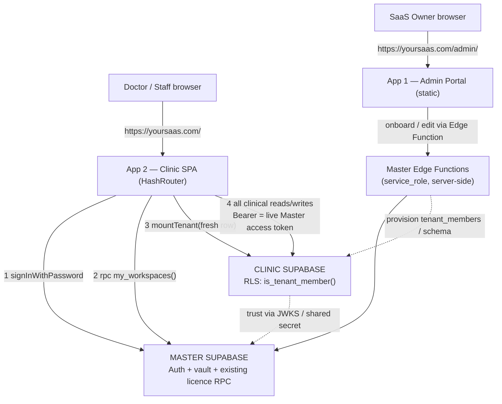

# Multi-Tenant OPD SaaS — Implementation Plan

**Database-per-tenant · two separate frontends · one Master Admin Supabase · single GitHub Pages domain**

Status: **PLAN ONLY** — no code, SQL, workflow, schema or repository changes have been made.
Scope: implementation planning for the brief in the user's message. Subscription / licence-validation RPC work is explicitly **out of scope** (treated as already implemented).

> **⚠ REVISION 2 AVAILABLE — read `/home/user/opd-multitenant-plan-improvements.md` before acting on this document.**
> A scan of both GitHub repos on 2026-11-11 changed several assumptions here: `myClinic v1.43.0` is now pushed to `main` (`b1e174e`), and `myClinicLicenseAuthority` has advanced from **v2.4.0 to v3.1.0 / schema v4** — it is now a full React admin console with an onboarding wizard, zero-trust RLS, RS256 signer, read coalescing and setup diagnostics. In particular: §0 A2, §1, §2 D1, §4–§7, §10, §11 P1/P2, §13 and the Appendix A operator note are superseded or amended. The v2.4.0 compat-pin to-do is already resolved upstream in Central v3.x. R1 §3-C2, §3-C3, §3-C6, §3-C7, §8 (`tenant_members` allowlist), §9.3/9.4/9.5 and §12 (ratchets) remain valid.

---

## 0. Document control, assumptions, and scope boundary

| # | Assumption | Why it matters | If wrong |
|---|---|---|---|
| A1 | `://yoursaas.com` is normalised to **`https://yoursaas.com`** for both apps. | All origin, CORS, redirect-URL and storage reasoning depends on one origin. | Rework §3-C4, §13. |
| A2 | **App 2 = the existing `myClinic` SPA** in `/home/user/myclinic` (v1.43.0, `b1e174e`, Vite 8 / React 19 / `HashRouter` / `react-router` 8 / `@supabase/supabase-js` ^2.118.0, 743 tests in 46 files, `SCHEMA_VERSION=21`, GitHub Pages on `rajeshlande.github.io/myClinic/`). The brief's phrase "running your existing subscription validation RPC" and "single static SPA on GitHub Pages" matches this repo exactly. | Determines whether this is a *migration* of 35+ Supabase call sites or a greenfield build. | If greenfield, drop §10 and §12.7 and halve Phase P5. The rest of the plan still applies. |
| A3 | **App 1 is a new, separate frontend project** (new source tree, new build output, separate env). | Checklist item 1. | — |
| A4 | "Two completely separate frontend web applications" means **separate codebases and bundles**, not separate origins. The brief forbids subdomains. | Forces a single Pages site with two entry points (§3-C4). | If subdomains are allowed later, use `admin.yoursaas.com` and simplify §13. |
| A5 | Existing v1.43.0 is the **rollback baseline**; the existing `no schema / env / wrangler / Pages workflow change` constraint applied to *that release only*. | This project inherently changes all four, so it must be a new release line (suggest `v2.0.0`). | If that constraint is meant to be permanent, this project cannot be built — escalate. |
| A6 | Clinic tenant projects are real, separate Supabase projects (one per clinic), each with its own URL and publishable/anon key. | Core of database-per-tenant. | — |
| A7 | Users are created in **Master Auth only**. Tenant projects have no local `auth.users`. | This is the source of the single biggest blocker, §3-C2. | If tenants have their own auth, use §2-D1 Option C variant. |

**Current-state facts verified by local inspection (not from web sources):**

- `src/lib/supabase.js` creates **one** module-level client from `VITE_SUPABASE_URL` / `VITE_SUPABASE_ANON_KEY`; exports `supabase`, `supabaseConfigured`, `authErrorMessage`.
- Direct importers of that singleton: `src/lib/auth-context.jsx` (8 uses), `src/lib/store.jsx` (**35 uses**), `src/pages/Setup.jsx` (5). `src/lib/public-booking.mjs` uses anon-granted SECURITY DEFINER RPCs (2).
- `src/lib/store.jsx` reads `profiles`, `staff`, `clinics`, `patients`, `appointments`, `consultations`, `invoices`, `day_closes`, `reminders`, `invites`, `branches`, `staff_branches` and calls RPCs `accept_invite`, `license_state`, `create_clinic`, `set_clinic_slug`, `create_branch`, `set_staff_branches`, `set_active_branch`, `set_branch_scope`, `search_medicine_brands`.
- `supabase/schema.sql` is one idempotent additive file with sections §0–§21 and a version registry.
- Offline cache / outbox keys in `src/lib/offline.js` are namespaced by `userId` + `clinicId` (`myclinic.outbox.v2.<user>`, `myclinic.sync.meta`, `cacheKey(userId, clinicId)`).
- `src/main.jsx` mounts `<HashRouter><AuthProvider><PWAProvider><ToastProvider>...`.
- `.github/workflows/pages.yml` already forwards `VITE_SUPABASE_*`, `VITE_CENTRAL_SUPABASE_*`, `VITE_BASE` and already **fails the build** if a `sb_secret|service_role` key reaches the bundle. That guard must be preserved and extended.
- The repo is clean at `b1e174e` with annotated tag `v1.43.0`.

---

## 1. Target architecture (restated with the corrections applied)

| Layer | Component | Connection | Holds |
|---|---|---|---|
| Hosting | **One** GitHub Pages site, custom domain `https://yoursaas.com`, `CNAME` committed | static | `/` → App 2, `/admin/` → App 1 |
| App 1 | Master Admin Portal (SaaS owner only) | **static** client → Master Supabase, own `storageKey` | Onboarding form, workspace list, membership editor, audit view |
| App 2 | Clinic Operational App (doctors/reception/staff) | **static Master client** + **ephemeral Tenant client** in RAM | Login, workspace discovery, all clinical operations |
| Master | Master Admin Supabase | single project | `auth.users`, `vault.workspaces`, `vault.workspace_members`, `vault.platform_admins`, `vault.audit_log`, licence RPCs (existing), onboarding Edge Functions |
| Tenant N | Isolated Supabase project per clinic | reached only by the Tenant client, URL + anon key read from Master at runtime | `patients`, `appointments`, `consultations`, `prescriptions`, `invoices`, `tenant_members`, `schema_meta`; strict RLS |



**The critical addition the brief omits:** the Tenant client must send a JWT that the *tenant* project accepts. It cannot create a tenant session from a URL + anon key alone. See §2-D1 and §3-C2.

---

## 2. Decision gates — resolve **before** any build work

These are blocking architectural decisions. Phases P1, P3, P4 and P5 cannot be started correctly until D1 is settled.

### D1 — Cross-project auth trust (BLOCKER, highest priority)

Master-issued access tokens are signed with the Master project's key. A tenant project validates JWTs against **its own** signing configuration, so a Master token is rejected (or, worse, treated as `anon`) unless the tenant is configured to trust it. Supabase's own maintainers describe the shared-secret approach directly: all projects can accept the same user JWT, and `auth.uid()` then resolves correctly inside RLS [2](https://github.com/orgs/supabase/discussions/16673). Supabase also supports injecting a user JWT into the client as the `Authorization` header for RLS [4](https://github.com/orgs/supabase/discussions/1849), and custom/external JWTs must carry a UUID `sub` so `auth.uid()` works [5](https://www.restack.io/docs/supabase-knowledge-supabase-jwt-secret-guide).

| Option | Mechanism | Pros | Cons | Verdict |
|---|---|---|---|---|
| **A. Third-party Auth / JWKS (recommended)** | Configure every tenant project's `third-party-auth` integration with the Master's public JWKS (`https://<master-ref>.supabase.co/auth/v1/.well-known/jwks.json`); pass the live Master access token to the Tenant client via `accessToken`. | No shared symmetric secret; no token-minting service; `auth.uid()` = Master user UUID; rotation is key-based. | Requires **asymmetric** (RS*/ES*) tokens with a `kid` header and a `role: 'authenticated'` claim; a community runbook reports a third-party-auth endpoint `POST /v1/projects/{ref}/config/auth/third-party-auth` accepting `oidc_issuer_url` / `jwks_url` / `custom_jwks`, and warns that **JWKS rotation can be cached for a long time** (a trusting project did not re-resolve over 116 probes / 20 minutes) [1](https://erfi.dev/guides/supabase-shared-tenancy/). Must verify against the pinned Supabase version. | **Choose A** if the Master project issues asymmetric JWTs (new signing keys) on the current plan. |
| **B. Shared legacy HS256 JWT secret** | Set the identical `jwt_secret` on Master and every tenant project; send Master token as `Authorization: Bearer`. | Simplest; well-trodden; no JWKS. | One symmetric secret shared across N projects = large blast radius; Supabase is moving to asymmetric signing keys; secret rotation must be atomic across all projects. | Fallback if A is unavailable. |
| **C. Token-broker Edge Function** | A Master Edge Function (holding each tenant's signing secret as an **encrypted Edge secret**, never in the browser) mints a short-lived tenant-scoped JWT with `sub`, `role`, `tenant_slug` and returns it to the SPA. | Gives a **per-workspace** claim (strongest tenant pinning); no global trust relationship; easy revocation. | Extra hop on every session; secret map to maintain; token-minting/refresh logic; more code. | Choose C if you need per-tenant claims (see §3-C2 residual risk) or cannot configure JWKS. |

> **Whichever option is chosen, add `public.tenant_members` to every tenant DB and gate all RLS on `public.is_tenant_member()` (§8).** With A or B, a Master JWT is valid on *every* tenant project; physical isolation alone would let a member of Clinic A — if they ever obtained Clinic B's URL and anon key — read Clinic B. A per-tenant allowlist closes that hole. This is the single most important hardening in this plan.

### D2 — Hosting topology

GitHub Pages maps **one custom domain to one site**, and does not mount multiple repos under subpaths of a single custom domain [1](https://github-help-wanted.com/github-pages/custom-domain/) [2](https://github.com/orgs/community/discussions/173106); the supported pattern is one repo with subdirectories served under one domain [4](https://github.com/orgs/community/discussions/164202), and one custom domain per repository [3](https://is-pro.dev/guides/set-up-github-pages-custom-subdomain/).

**Recommendation:** a monorepo (or one Pages-publishing repo) with two independent Vite projects whose outputs are aggregated by CI into a single `dist/`:

```
dist/
  CNAME                    # https://yoursaas.com — must survive every deploy
  index.html               # App 2, assets relative ("./")
  assets/…                 # App 2 chunks
  admin/
    index.html             # App 1, assets relative ("./")
    assets/…               # App 1 chunks
```

Both apps keep `HashRouter` (`/#/app/dashboard`, `/admin/#/workspaces`), because GH Pages has no SPA rewrite. `vite.config.js` keeps `base: './'`; avoid `VITE_BASE` absolute paths for `/admin/`. Verify the `CNAME` file is present in the published artifact on every run.

### D3 — Where the role lives

`workspace_members.role` (Master) is authoritative for **who may enter which workspace**; tenant-side `tenant_members.role` is a **provisioned mirror** used for tenant RLS (doctor vs staff write permissions). Never read the tenant copy to decide workspace access. Document a sync contract and a drift test.

### D4 — Anonymous/public surfaces

The existing public booking flow (`/#/book/<slug>`) has no logged-in user and therefore no workspace row. Decide between:

- **D4-a (recommended):** add a Master `public.public_workspace_by_slug(p_slug)` SECURITY DEFINER RPC returning only `{ supabase_url, anon_key, is_active }` for an active workspace; the booking page resolves the tenant client anonymously and calls the tenant's existing anon-safe booking RPCs. Note: a tenant anon key is a public key, so returning it to a stranger is acceptable; the tenant's booking RPCs must stay `SECURITY DEFINER` and return only busy intervals and the booking itself.
- **D4-b:** route all public booking through a Master Edge Function proxy (stronger, hides tenant URLs entirely, adds a backend hop).
- **D4-c:** give each clinic a per-clinic booking link containing the slug plus a signed, short-lived tenant pointer.

This must be decided before P5 because `public-booking.mjs`, `Setup.jsx`, `Landing.jsx` and the settings "booking link" copy all assume a single project.

### D5 — Existing data cutover

If A2 holds, migrating the current shared-DB `myclinic` data to per-tenant projects is a project in its own right (§10). Decide: single big-bang cutover, or a pilot clinic first with the old shared project kept read-only as a fallback. **Recommend pilot-first.**

---

## 3. Critical corrections to the brief (why the naive version fails)

| ID | Issue | Failure mode if built literally | Correction |
|---|---|---|---|
| **C1** | "Anon Key" is called a **secret** and stored in a "Connection Vault". | Supabase anon/publishable keys are public by design; they are meant to be in the browser. Protecting them with RLS buys obfuscation, not confidentiality. Worse, a careless operator may paste a `service_role` / `sb_secret_` key, which bypasses RLS entirely; a community runbook explicitly warns to keep `service_role` and `sb_secret_` off every tenant-reachable surface [1](https://erfi.dev/guides/supabase-shared-tenancy/). | Rename the table to a **connection directory**; add a `CHECK` rejecting `service_role|sb_secret`; keep the existing `pages.yml` bundle scan; add a ratchet asserting no client-readable RPC ever returns a privileged key column. Tenant RLS is the real security boundary. |
| **C2** | The SPA gets only `supabase_url` + `supabase_anon_key`. **No tenant auth session is ever established.** | `createClient(url, anonKey)` sends requests as `anon`. Step 4 requires "only authenticated sessions can read/write" → every clinical query returns `401`/empty and the app is dead on arrival. `auth.uid()` is `NULL` for unauthenticated requests [3](https://designrevision.com/blog/supabase-row-level-security). | Implement D1 (A/B/C) and pass a **live** token callback, not a snapshot: `accessToken: async () => (await master.auth.getSession()).data.session?.access_token ?? null`. Confirm `accessToken` exists in the pinned `@supabase/supabase-js` ^2.118.0 (the server client reference confirms `accessToken` is part of `SupabaseClientOptions` and is stripped in server contexts [3](https://supabase.com/docs/reference/server/frameworks)). If absent, either upgrade the pin or fall back to `global.headers.Authorization` **plus** recreate the Tenant client on `onAuthStateChange('TOKEN_REFRESHED')` — `global.headers` is static [1](https://supabase.com/docs/reference/javascript/initializing) and a 1-hour-old token will silently expire. |
| **C3** | Slug-scoped `localStorage` keys are claimed to give multi-tab isolation, while active details are cached in browser storage. | `localStorage` is **shared across all tabs of an origin**. One `active_workspace` key is last-write-wins: open Clinic A in tab 1, Clinic B in tab 2, refresh tab 1 → it silently loads Clinic B. Clinical data shown in the wrong clinic context is a patient-safety issue, not a cosmetic one. | Put the **active workspace pointer in `sessionStorage`** (per-tab) with a `localStorage` "last used" hint only. Keep slug-scoped keys for anything persisted. Add an e2e test that opens two tabs with different slugs and asserts each keeps its own clinic after refresh. Also note the `dispose()` caveat: an in-flight refresh can persist a rotated session after disposal, so either await pending auth ops before disposal or use a different `storageKey` for the replacement client [1](https://supabase.com/docs/reference/javascript/initializing). |
| **C4** | Two "completely separate" apps both at `https://yoursaas.com`, GitHub Pages, zero subdomains. | GH Pages cannot serve two repos under one custom domain [2](https://github.com/orgs/community/discussions/173106) [1](https://github-help-wanted.com/github-pages/custom-domain/). | D2: one Pages site, `/` + `/admin/`, one `CNAME`, two independent bundles. |
| **C5** | Both apps share an origin **and** the same Master Auth project. | With the same default `auth.storageKey`, an admin signed into `/admin` is also signed in at `/`, and a staff user visiting `/admin` is "authenticated". Storage is origin-scoped, not path-scoped. | Distinct `storageKey` per app (`opd.admin.master.auth` vs `opd.clinic.master.auth`) **plus** a server-side `vault.is_platform_admin()` check on every admin RPC/Edge Function. Never rely on the UI route guard. |
| **C6** | "Cache these active details in browser storage so refreshing keeps the user inside their chosen clinic." | Cached credentials become authoritative: a revoked membership, `is_active=false` clinic, or rotated anon key keeps working indefinitely. | Cache only a **slug hint**. On every boot re-run `rpc('my_workspaces')` under Master RLS and mount from the **fresh** row; if the slug is gone or inactive, drop to the selector. |
| **C7** | Offline-first cache/outbox. | `myclinic.outbox.v2.<userId>` and `cacheKey(userId, clinicId)` are not tenant-aware. One doctor in two clinics shares an outbox → replay writes Clinic A rows into Clinic B. | Namespace **all** persisted keys by slug: `myclinic.<kind>.v3.<slug>.<userId>`. Bind the outbox replay to the active Tenant client. Extend `clearAllCache()` to purge every `opd.*` and `myclinic.*` key. |
| **C8** | Public booking / anonymous links (§2-D4). | No session → no workspace discovery → booking page cannot resolve a tenant DB. | D4-a/b/c. |
| **C9** | "Ensure every clinic instance has the exact same schema." | Manual provisioning drifts; a client built for schema 21 hits a schema 19 tenant. | Versioned `tenant-schema.sql` with a `schema_meta.version` table, templated provisioning, a CI job that applies it to a scratch project, and a boot-time `readTenantSchemaVersion()` guard with a clear "clinic needs an update" screen. |
| **C10** | Realtime subscriptions. | Realtime RLS uses a separate auth path; without wiring the token, subscriptions are anonymous or stale. | Call `client.realtime.setAuth(token)` / rely on the `accessToken` callback; `setAuth()` without arguments restores callback behaviour [2](https://supabase.com/docs/reference/javascript/release-notes) [1](https://supabase.com/docs/reference/javascript/initializing). Include this in the P4 acceptance tests. |
| **C11** | Admin writes directly from the browser. | Any authenticated user who can reach the admin bundle could try `insert` on `workspaces`; RLS must be perfect with no audit trail. | Route onboarding through a Master Edge Function with `service_role`, verify `vault.is_platform_admin()`, validate inputs, and write an immutable `audit_log` row. |
| **C12** | `is_active` and licence verdict. | Enforced only in UI → a deactivated or expired clinic still works. | `my_workspaces()` filters `is_active = true`; call the existing licence-validation RPC **between Stage 2 and Stage 3** and gate the Tenant client mount (and tenant writes) on its verdict. |

---

## 4. Data model — Master Admin Supabase (proposed DDL, to be authored in P1)

Design choice: keep the connection directory in a **non-exposed `vault` schema** and expose data only through SECURITY DEFINER RPCs. This is strictly stronger than the brief's "public `workspaces` table with a SELECT policy": the base tables can never be reached by PostgREST, column leakage is impossible, and keys can be redacted later without a client change. The brief's minimal variant is given at the end of §5.

```sql
-- ── P1.1  schema isolation ────────────────────────────────────────────────
create schema if not exists vault;
revoke all on schema vault from anon, authenticated, public;
grant usage on schema vault to service_role;

-- ── P1.2  connection directory ───────────────────────────────────────────
create table vault.workspaces (
  id                     uuid primary key default gen_random_uuid(),
  clinic_name            text not null check (length(clinic_name) between 2 and 120),
  slug                   text not null unique
                           check (slug ~ '^[a-z0-9][a-z0-9-]{1,38}[a-z0-9]$'),
  supabase_url           text not null
                           check (supabase_url ~ '^https://[a-z0-9-]+\.supabase\.co/?$'),
  supabase_anon_key      text not null
                           check (supabase_anon_key !~* 'service_role|sb_secret'),
  is_active              boolean not null default false,
  tenant_schema_version  integer not null default 0,
  created_at             timestamptz not null default now(),
  updated_at             timestamptz not null default now()
);

create table vault.workspace_members (
  workspace_id uuid not null references vault.workspaces(id) on delete cascade,
  user_id      uuid not null references auth.users(id)      on delete cascade,
  role         text not null check (role in ('admin','doctor','staff')),
  granted_at   timestamptz not null default now(),
  primary key (workspace_id, user_id)
);
create index workspace_members_user_idx on vault.workspace_members (user_id);

create table vault.platform_admins (
  user_id     uuid primary key references auth.users(id) on delete cascade,
  note        text,
  created_at  timestamptz not null default now()
);

create table vault.audit_log (
  id          bigserial primary key,
  actor       uuid not null,
  action      text not null,
  workspace   uuid,
  detail      jsonb not null default '{}'::jsonb,
  at          timestamptz not null default now()
);

-- ── P1.3  RLS: default-deny everything, no policies for anon/authenticated ──
alter table vault.workspaces        enable row level security;
alter table vault.workspace_members enable row level security;
alter table vault.platform_admins   enable row level security;
alter table vault.audit_log         enable row level security;
revoke all on all tables in schema vault from anon, authenticated, public;
```

> **Never** store a tenant `service_role` / `sb_secret_` key in `vault.workspaces`. If a provisioning function needs it, keep it in an encrypted Edge Function secret map keyed by slug (or Supabase Vault), never in a table that a SECURITY DEFINER RPC could one day accidentally select.

---

## 5. RLS helpers and RPCs (proposed SQL, P1)

`SECURITY DEFINER` + `SET search_path = ''` + fully-qualified names avoids both RLS recursion and search-path hijacking. This also sidesteps the classic recursive-policy problem when a `workspaces` policy queries `workspace_members`.

```sql
-- ── P1.4  helpers ─────────────────────────────────────────────────────────
create or replace function vault.is_platform_admin()
returns boolean language sql stable security definer set search_path = '' as $$
  select exists (select 1 from vault.platform_admins a where a.user_id = auth.uid());
$$;
revoke all on function vault.is_platform_admin() from public, anon, authenticated;
grant execute on function vault.is_platform_admin() to authenticated, service_role;

create or replace function vault.is_workspace_member(p_workspace uuid)
returns boolean language sql stable security definer set search_path = '' as $$
  select exists (
    select 1 from vault.workspace_members m
    where m.workspace_id = p_workspace and m.user_id = auth.uid()
  );
$$;
revoke all on function vault.is_workspace_member(uuid) from public, anon, authenticated;
grant execute on function vault.is_workspace_member(uuid) to authenticated, service_role;

-- ── P1.5  Stage-2 discovery: the ONLY client-readable connection data ──────
create or replace function public.my_workspaces()
returns table (
  id uuid, clinic_name text, slug text, supabase_url text, supabase_anon_key text,
  role text, is_active boolean, tenant_schema_version integer
)
language sql stable security definer set search_path = '' as $$
  select w.id, w.clinic_name, w.slug, w.supabase_url, w.supabase_anon_key,
         m.role, w.is_active, w.tenant_schema_version
  from vault.workspaces w
  join vault.workspace_members m on m.workspace_id = w.id
  where m.user_id = auth.uid()
    and w.is_active = true
  order by w.clinic_name;
$$;
revoke all on function public.my_workspaces() from public, anon;
grant execute on function public.my_workspaces() to authenticated;

-- ── P1.6  anonymous booking directory (D4-a) ─────────────────────────────
create or replace function public.public_workspace_by_slug(p_slug text)
returns table (clinic_name text, slug text, supabase_url text, supabase_anon_key text)
language sql stable security definer set search_path = '' as $$
  select w.clinic_name, w.slug, w.supabase_url, w.supabase_anon_key
  from vault.workspaces w
  where w.slug = p_slug and w.is_active = true;
$$;
revoke all on function public.public_workspace_by_slug(text) from public, authenticated;
grant execute on function public.public_workspace_by_slug(text) to anon;

-- ── P1.7  onboarding (called by the Edge Function with service_role) ───────
create or replace function vault.onboard_workspace(
  p_clinic_name text, p_slug text, p_supabase_url text,
  p_supabase_anon_key text, p_owner_user_id uuid
) returns uuid
language plpgsql volatile security definer set search_path = '' as $$
declare v_id uuid;
begin
  if not vault.is_platform_admin() then
    raise exception 'not a platform admin' using errcode = '42501';
  end if;
  insert into vault.workspaces (clinic_name, slug, supabase_url, supabase_anon_key, is_active)
  values (p_clinic_name, p_slug, p_supabase_url, p_supabase_anon_key, false)
  returning id into v_id;

  insert into vault.workspace_members (workspace_id, user_id, role)
  values (v_id, p_owner_user_id, 'admin');

  insert into vault.audit_log (actor, action, workspace, detail)
  values (auth.uid(), 'workspace.onboard', v_id,
          jsonb_build_object('slug', p_slug, 'owner', p_owner_user_id));
  return v_id;
end $$;
revoke all on function vault.onboard_workspace(text,text,text,text,uuid)
  from public, anon, authenticated;
grant execute on function vault.onboard_workspace(text,text,text,text,uuid) to service_role;
```

**Minimal variant (if you insist on the brief's literal "public `workspaces` table"):**

```sql
alter table public.workspaces enable row level security;
create policy workspaces_member_select on public.workspaces
  for select to authenticated
  using (is_active and vault.is_workspace_member(id));

alter table public.workspace_members enable row level security;
create policy members_self_select on public.workspace_members
  for select to authenticated using (user_id = auth.uid());

create policy workspaces_admin_all on public.workspaces
  for all to authenticated
  using (vault.is_platform_admin()) with check (vault.is_platform_admin());

revoke all on public.workspaces, public.workspace_members from anon;
revoke insert, update, delete on public.workspaces from authenticated;
revoke insert, update, delete on public.workspace_members from authenticated;
```

Acceptance for §4–§5: an `anon` request returns zero rows on every table/function; an authenticated non-member returns zero rows from `my_workspaces()`; a member returns only their rows; a non-admin `vault.onboard_workspace()` call raises `42501`; `is_active=false` rows never appear; a `service_role|sb_secret` value is rejected by the CHECK constraint.

---

## 6. Master Edge Functions (P1/P2)

| Function | Caller | Auth check | Action |
|---|---|---|---|
| `admin-onboard` | App 1, with admin's Master JWT | `vault.is_platform_admin()` | Validate slug/URL/key shape, verify target project reachable and its `schema_meta.version`, call `vault.onboard_workspace()`, then `provision-tenant` (below), then set `is_active=true`, write `audit_log`. |
| `admin-set-active` | App 1 | admin | Flip `is_active`; write audit row. |
| `admin-set-member` | App 1 | admin | Add/remove/change `workspace_members`; sync tenant `tenant_members`. |
| `provision-tenant` | internal (service_role only) | n/a | Apply `tenant-schema.sql` to the target project (via Management API / psql in CI), upsert `tenant_members` from `workspace_members`, set `schema_meta.version`. |
| `admin-rotate-key` | App 1 | admin | Replace `supabase_anon_key`, bump `updated_at`, write audit row; all clients revalidate on next boot (C6). |

Rules: verify the caller using the JWT (not a header the client sends); never return `service_role` keys; validate `supabase_url` against an allowlist regex; rate-limit; log every mutation.

---

## 7. App 1 — Master Admin Portal (P2)

```
admin/
  index.html
  vite.config.js                     # base './', outDir '../../dist/admin'
  src/main.jsx                       # HashRouter basename-free, /admin/#/...
  src/App.jsx                        # RequirePlatformAdmin gate
  src/lib/master-admin-client.js     # THE ONLY createClient in this app
  src/lib/admin-api.mjs              # Edge Function calls only
  src/pages/Workspaces.jsx
  src/pages/OnboardClinic.jsx        # clinic_name, slug, url, anon key, owner user id
  src/pages/Members.jsx
  src/pages/Audit.jsx
```

```js
// master-admin-client.js — static, build-time env, distinct storageKey (C5)
import { createClient } from '@supabase/supabase-js';
export const adminMaster = createClient(
  import.meta.env.VITE_MASTER_SUPABASE_URL,
  import.meta.env.VITE_MASTER_SUPABASE_ANON_KEY,
  { auth: { storageKey: 'opd.admin.master.auth', persistSession: true,
            autoRefreshToken: true, detectSessionInUrl: true, flowType: 'pkce' } },
);
```

**Onboarding form fields:** `clinic_name`, `slug`, `supabase_url`, `supabase_anon_key`, `owner_user_id` (or owner email → resolved to UUID by the Edge Function via `auth.admin`), `tenant_schema_version` target. Client-side validation mirrors the SQL CHECKs; the Edge Function re-validates everything. Show the preview of the resolved URL with the key masked.

**Hard rule:** this app contains **zero** dynamic `createClient` calls, zero `workspaces.supabase_url`-driven clients, zero `mountTenant`. Enforced by `check:admin-static` (§12).

---

## 8. Tenant Supabase template (P3)

Derived from the existing `supabase/schema.sql` (§0–§21) but with `clinic_id` removed/constant and a new §22 for tenant identity. Templated with `{{SLUG}}`.

```
supabase/tenant/
  tenant-schema.sql            # idempotent, additive, one file per tenant version
  tenant-schema-tests.sql      # psql regression: RLS deny-by-default matrix
  README.md                    # provisioning runbook
```

```sql
-- tenant identity: the per-tenant allowlist that closes the C2 residual risk
create table public.tenant_members (
  user_id     uuid primary key,               -- Master Auth user UUID
  role        text not null check (role in ('admin','doctor','staff')),
  updated_at  timestamptz not null default now()
);
alter table public.tenant_members enable row level security;
revoke all on public.tenant_members from anon, authenticated;  -- service_role sync only

create or replace function public.is_tenant_member()
returns boolean language sql stable security definer set search_path = '' as $$
  select exists (select 1 from public.tenant_members m where m.user_id = auth.uid());
$$;
revoke all on function public.is_tenant_member() from public, anon;
grant execute on function public.is_tenant_member() to authenticated;

create table public.schema_meta (version integer not null, applied_at timestamptz default now());
insert into public.schema_meta (version) values (21);

-- example: identical policy shape on every clinical table
alter table public.patients enable row level security;
create policy patients_tenant_read on public.patients
  for select to authenticated using (public.is_tenant_member());
create policy patients_tenant_write on public.patients
  for all to authenticated
  using (public.is_tenant_member())
  with check (public.is_tenant_member()
              and public.tenant_role() in ('admin','doctor','staff'));
```

Repeat for `appointments`, `consultations`, `prescriptions`, `invoices`, `day_closes`, `reminders`, `branches`, `staff_branches`, and any other clinical table. **No policy may target `anon`** except the deliberately public booking RPCs. Add a regression query in `tenant-schema-tests.sql` that asserts, for every table in `information_schema.tables`, that RLS is enabled and at least one policy exists.

If D1 Option C is chosen, additionally pin `auth.jwt()->>'tenant_slug' = '{{SLUG}}'` in every policy using template substitution at provisioning time.

---

## 9. App 2 — Clinic Operational App: the dynamic connection engine (P4)

### 9.1 Module contracts

```js
// src/lib/master-client.js  (replaces today's src/lib/supabase.js singleton export)
export const master = createClient(
  import.meta.env.VITE_MASTER_SUPABASE_URL,
  import.meta.env.VITE_MASTER_SUPABASE_ANON_KEY,
  { auth: { storageKey: 'opd.clinic.master.auth', persistSession: true,
            autoRefreshToken: true, detectSessionInUrl: true, flowType: 'pkce' } },
);
export const masterConfigured = /* boolean, same guard as today minus service_role regex */;
```

```js
// src/lib/tenant-client.js  — the ONLY place a second client is created
let active = null;                       // RAM only; never a module-level singleton export

export function mountTenant(workspace) {
  if (active) disposeTenant();
  const client = createClient(workspace.supabase_url, workspace.supabase_anon_key, {
    // LIVE token (C2): never snapshot the access_token at mount time
    accessToken: async () =>
      (await master.auth.getSession()).data.session?.access_token ?? null,
    auth: {
      persistSession: false,             // no independent tenant session exists
      autoRefreshToken: false,
      detectSessionInUrl: false,
      storageKey: `opd.tenant.${workspace.slug}.auth`,   // defensive, C3
    },
    global: { headers: { 'X-OPD-Workspace': workspace.slug } },
  });
  active = { slug: workspace.slug, workspace, client, mountedAt: Date.now() };
  return active;
}

export function disposeTenant() {
  if (!active) return;
  active.client.removeAllChannels();
  active.client.realtime.setAuth(null);
  active = null;                         // drop the reference; GC the client
}

export function useTenantClient() {       // the ONLY accessor operational code may use
  if (!active) throw new Error('No clinic workspace is mounted');
  return active.client;
}
export const activeWorkspace = () => active?.workspace ?? null;
```

`TenantProvider` wraps the existing `<AuthProvider>` subtree and exposes `useTenant()`, `useWorkspace()`, `selectWorkspace()`, `signOut()`.

### 9.2 Three-stage boot gate

```
Boot
 ├─ Stage 1  master.auth.getSession()
 │            none → /login (Master email+password, PKCE, redirect allowlist)
 ├─ Stage 2  const rows = await master.rpc('my_workspaces')   // fresh, RLS-filtered (C6)
 │            0 rows → "No clinic assigned" screen (support contact, sign out)
 │            1 row  → auto-select, no UI
 │            >1 row → /select  (clean grid: clinic name, slug, role; keyboard accessible)
 ├─ Stage 2.5  validate the slug hint from sessionStorage against rows;
 │             call the EXISTING licence-validation RPC → gate on verdict (C12)
 └─ Stage 3  mountTenant(freshRow)  → <TenantProvider> → existing <App />
```

Revalidation contract: the cached value is a **slug hint only**. Never mount from cached `supabase_url` / `supabase_anon_key`. On every boot, on `onAuthStateChange('SIGNED_IN'|'TOKEN_REFRESHED')`, and when the tab regains visibility, re-read `my_workspaces()`; if the active slug disappeared or went inactive, `disposeTenant()` and route to `/select` or the no-workspace screen.

### 9.3 Storage policy (C3, C6, C7)

| Data | Store | Key | Scope |
|---|---|---|---|
| Active workspace pointer | `sessionStorage` | `opd.active.workspace` = `{ id, slug }` | **per tab** — this is the actual multi-tab isolation |
| Last-used hint (convenience for new tabs) | `localStorage` | `opd.last.workspace` = slug | origin-wide, non-authoritative |
| Master Auth session (App 2) | `localStorage` | `opd.clinic.master.auth` | origin-wide, distinct from App 1 (C5) |
| Tenant client session | none | — | no independent session; `storageKey` kept defensive only |
| Offline cache / outbox / sync meta | `localStorage` | `myclinic.<kind>.v3.<slug>.<userId>` | **slug-namespaced** |
| Invite token / error | `sessionStorage` | `myclinic.invite.<slug>` | slug-namespaced |

### 9.4 Clean sign-out sequence (checklist item 3)

1. `disposeTenant()` → `removeAllChannels()`, `realtime.setAuth(null)`, `active = null`.
2. `await master.auth.signOut({ scope: 'global' })`.
3. `sessionStorage.removeItem('opd.active.workspace')`; `localStorage.removeItem('opd.last.workspace')`.
4. `clearAllCache()` **extended** to purge every `opd.*` and `myclinic.*` key, including outbox and demo snapshot.
5. Reset React state, `navigate('/login', { replace: true })`.
6. `new BroadcastChannel('opd-auth').postMessage('sign-out')` so other tabs (including tabs on a different clinic) drop their clients too — Master Auth is one browser-wide session, so logout must be global.

### 9.5 The accessor ratchet (checklist item 3, mutation-proved)

- Allowlist: **only** `src/lib/master-client.js`, `src/lib/tenant-client.js`, `src/lib/auth-context.jsx` and `src/lib/licensing-adapter.js` may import `master`.
- Any `import … from './supabase.js'` / `master-client.js` outside the allowlist fails `npm test`.
- Any `master.from(...)` on a clinical table (`patients`, `appointments`, `consultations`, `prescriptions`, `invoices`, `day_closes`, `reminders`, `branches`, `staff_branches`) fails a grep ratchet.
- Mutation test: inject one `master.from('patients')` call into a component and assert the ratchet fails; inject a fictional workspace literal into `mountTenant` and assert the "no hardcoded tenant keys" ratchet fails.

---

## 10. Migrating the existing `myClinic` code (only if A2 holds)

| File / area | Today | Target |
|---|---|---|
| `src/lib/supabase.js` | one singleton, `VITE_SUPABASE_*` | split into `master-client.js` + `tenant-client.js`; keep `authErrorMessage` |
| `src/lib/auth-context.jsx` | signs in/out against the singleton | point at `master`; add Stage-2 discovery state; extend `signOut()` per §9.4; keep `clearAllCache()` |
| `src/lib/store.jsx` (35 refs) | reads `clinics`/`staff`/`profiles` and clinical tables from one project | **directory reads (`clinics`, `staff`, `profiles`, invites, licence RPCs) → `master`**; **all clinical reads/writes → `useTenantClient()`**. Split into `DirectoryProvider` + `ClinicalStore` to make the ratchet meaningful. |
| `src/lib/offline.js`, `offline-queue.js`, `offline-cache.js` | keys by `userId + clinicId` | slug-namespaced v3 keys; outbox bound to the active Tenant client |
| `src/lib/public-booking.mjs`, `src/pages/PublicBooking.jsx`, `BookingManage.jsx`, `Landing.jsx`, `src/components/settings/ClinicTab.jsx` | anon RPCs on the single project | resolve tenant via D4; re-test booking-link copy and `clinicSlug()` parity |
| `src/pages/Setup.jsx` | documents `VITE_SUPABASE_URL/ANON_KEY` | document the new Master-only env; convert to an operator diagnostic |
| `src/pages/Onboarding.jsx`, `Signup.jsx`, `Team.jsx`, `Subscription.jsx` | `create_clinic`, `accept_invite`, `license_state`, `set_clinic_slug` | move clinic creation to App 1 / Edge Functions; invites and licence stay Master-side |
| `supabase/schema.sql` §0–§21 | single shared DB, `clinic_id` on all tables | split into `master-schema.sql` (vault + licence) and `tenant/tenant-schema.sql` (clinical, no `clinic_id`) |
| `.github/workflows/pages.yml` | one `vite build` | build both apps, aggregate into `dist/`, keep `CNAME`, keep the `sb_secret|service_role` bundle guard, add the ratchet steps |
| `README.md`, `CONTRIBUTING.md`, `src/lib/version.js`, `CHANGELOG.md` | v1.43.0, 743 tests / 46 files, schema 21 | new release line (suggest `v2.0.0`), updated counts, operator runbook |

**Data migration (P8):** export per-clinic rows from the shared DB, remap or drop `clinic_id`, preserve Master Auth UUIDs so `auth.uid()` stays stable, seed `tenant_members`, re-point public booking slugs, replay/clear outboxes, and validate counts and checksums per table before cutting over. Keep the shared project read-only as a fallback for the pilot window.

---

## 11. Phased work plan

| Phase | Deliverables | Acceptance criteria | Depends on |
|---|---|---|---|
| **P0 — Decisions & prerequisites** | Written D1–D5 decisions; confirm Master project issues asymmetric JWTs; confirm `accessToken` support in `@supabase/supabase-js` ^2.118.0; provision 2 scratch tenant projects; confirm `https://yoursaas.com` DNS + domain verification. | A Master access token is accepted by a scratch tenant and `auth.uid()` returns the Master UUID in a test RLS policy. D1 signed off. | — |
| **P1 — Master schema & security** | §4/§5 SQL as versioned migration; 3 Edge Functions; `master-schema.sql`; `master-schema-tests.sql`. | `anon` sees nothing; non-member sees nothing; `42501` on non-admin onboarding; `is_active=false` invisible; `service_role|sb_secret` rejected; audit row per mutation. | P0 |
| **P2 — App 1 Admin Portal** | New `admin/` project, static client, onboarding form, workspace list, member editor, audit view, `RequirePlatformAdmin`. | Checklist item 1 passes; a staff account gets `42501` from every admin endpoint; onboarding creates workspace + member + tenant `tenant_members` + audit row. | P1 |
| **P3 — Tenant template** | `tenant-schema.sql` (§22), `tenant-schema-tests.sql`, provisioning script, `schema_meta`, CI scratch-project job. | Two independently provisioned tenants report identical `schema_meta.version`, identical table/policy inventory, and deny all `anon` clinical reads. | P0, D1 |
| **P4 — App 2 dual-client engine** | `master-client.js`, `tenant-client.js`, `TenantProvider`, 3-stage gate, workspace selector UI, storage policy, logout, revalidation. | Login → 1 clinic auto-selects → 2 clinics show grid → refresh keeps the same clinic → two tabs with different slugs stay isolated → logout wipes RAM + all keys. Realtime RLS works. | P1, P3 |
| **P5 — App 2 operational migration** | Split `store.jsx`; slug-namespaced offline layer; public booking per D4; Setup/docs updates. | All clinical components use `useTenantClient()`; checklist item 3 passes; existing 743 tests still pass (adapted); outbox replay lands in the correct tenant. | P4, D4 |
| **P6 — Tests, ratchets, security** | §12 suite; mutation tests; `npm run test:security`; PG17 RLS regression; secret scans. | Every ratchet fails on its injected mutation; no `service_role` string in `dist/`; zero hardcoded tenant URLs/keys. | P2–P5 |
| **P7 — CI/CD & Pages topology** | Two builds → one `dist/`, `CNAME`, hash routing for both, domain verification, Enforce HTTPS, `check:pages` updated. | Both `/` and `/admin/` load on the custom domain with relative assets; refresh and deep hash links work; `npm run verify` green. | P2–P6 |
| **P8 — Pilot & cutover** | 1 pilot clinic migrated, feature flag `VITE_MULTI_TENANT`, rollback rehearsal, operator runbook, v2.0.0 tag. | Pilot staff complete a full day (login → patient → appointment → consultation → invoice → day close); rollback to v1.43.0 restores the old flow in < 15 min. | all |

**Effort shape:** P5 is the largest (35 Supabase call sites, offline layer, public booking); P8 is the riskiest. P0 is small but blocks everything.

---

## 12. Test & verification plan

### 12.1 Mapping to the brief's checklist

| # | Brief check | Automated enforcement |
|---|---|---|
| 1 | Master Admin App contains **zero** dynamic tenant-switching logic | `scripts/check-admin-static.mjs`: exactly **1** `createClient(` in `admin/src/`, using `import.meta.env`; zero occurrences of `mountTenant`, `supabase_anon_key`, `my_workspaces`, `workspaces.select`, `VITE_*TENANT*`; zero `supabase.co` literals in `dist/admin/`. |
| 2 | Clinic App contains **zero** hardcoded clinic URLs/keys | `scripts/check-no-tenant-secrets.mjs`: scan `src/`, `.env.example`, `scripts/`, `dist/assets/` for `https://*.supabase.co`, `sb_publishable_`, `eyJ…` and any `VITE_*TENANT*`/`VITE_SUPABASE_*`-per-clinic name. Master URL/key in build-time env is **allowed and expected**; add an explicit allowlist comment so the ratchet stays readable. Keep the existing `pages.yml` `sb_secret|service_role` guard. |
| 3 | All medical forms/tables use the Dynamic Tenant Client | `scripts/check-tenant-accessor.mjs`: import allowlist (§9.5) + ban `master.from(<clinical table>)` + ban `import … from './supabase.js'`. Component tests assert `useTenantClient()` is called and `master` is never used for patient/appointment/invoice reads. |

### 12.2 Additional gates

- **Mutation-proved ratchets** (mirroring the existing cross-repo drift test style): inject a hardcoded tenant URL → item 2 fails; inject `master.from('patients')` → item 3 fails; inject a second `createClient` in App 1 → item 1 fails; inject a `localStorage`-only active pointer → tab-isolation test fails; inject a snapshot `access_token` → token-refresh test fails.
- **RLS regression SQL** (`master-schema-tests.sql`, `tenant-schema-tests.sql`, run under PG17 as in the current release process): `anon` deny, non-member deny, admin-only write, `is_active` filter, default-deny on `tenant_members`, every clinical table has RLS + policy.
- **Boot-flow unit tests:** 0/1/N workspaces, inactive row, removed membership, rotated key, expired licence verdict, cached-slug mismatch.
- **Storage tests:** per-tab pointer, slug-namespaced outbox, logout purge completeness (assert `localStorage.length` and `sessionStorage.length` after sign-out), `BroadcastChannel` sign-out fan-out.
- **e2e (two-tab):** open Clinic A and Clinic B, refresh both, assert each renders its own clinic name and writes to its own tenant project.
- **Existing suite:** keep 743/743 green; update README/CONTRIBUTING counts for the new files; `npm run verify`, `check:pages`, `test:security`, build, and clean-clone verification.

### 12.3 Go / no-go checklist

- [ ] D1 signed off and a Master token verified on a scratch tenant with `auth.uid()` correct
- [ ] `tenant_members` allowlist present on every tenant and used by every clinical policy
- [ ] No `service_role` / `sb_secret_` key in any client-readable row or `dist/` asset
- [ ] `is_active` + licence verdict gate the mount
- [ ] Cached slug revalidated on every boot; cached credentials never trusted
- [ ] `sessionStorage` active pointer; two-tab test green
- [ ] Logout wipes RAM, both storage scopes, outbox and demo snapshot
- [ ] All three brief checklist items pass AND fail on their injected mutations
- [ ] `CNAME` present in published `dist/`; both apps load on `https://yoursaas.com`
- [ ] Rollback to `v1.43.0` rehearsed

---

## 13. CI/CD and GitHub Pages deployment

1. **Build matrix:** `npm ci` once; `vite build` for App 2 → `dist-clinic/`; `vite build` for App 1 (`--config admin/vite.config.js`) → `dist-admin/`; aggregate into `dist/` with `dist/admin/`; write `CNAME`.
2. **Env:** single set of **Master-only** variables (`VITE_MASTER_SUPABASE_URL`, `VITE_MASTER_SUPABASE_ANON_KEY`, `VITE_BASE` if needed, existing `VITE_CENTRAL_SUPABASE_*` unchanged). **No per-clinic variables.** Reject any new `VITE_*` name matching `TENANT|CLINIC_.*SUPABASE`.
3. **Guards in the workflow:** the existing `sb_secret|service_role` bundle scan; new `check-admin-static`, `check-no-tenant-secrets`, `check-tenant-accessor`; assert `CNAME === 'yoursaas.com'`.
4. **Auth configuration:** Master Auth redirect allowlist includes `https://yoursaas.com/` and `https://yoursaas.com/admin/` (hash fragments included where applicable); Site URL set; every tenant project allows the origin for REST/Auth/Realtime; PKCE flow preserved.
5. **Domain:** verify the domain in GitHub to reduce takeover risk; `CNAME` committed in the publishing source so CI deploys don't drop it; Enforce HTTPS after certificate provisioning [1](https://github-help-wanted.com/github-pages/custom-domain/).
6. **Release pattern:** keep the established bundle → verify → `git merge --ff-only <tag>` → push `main` + tags flow; **no `--force`** on release tags.

---

## 14. Security hardening and operator runbooks

| Runbook | Trigger | Steps |
|---|---|---|
| **Revoke a user** | Staff leaves a clinic | Edge Function removes `workspace_members` row AND the tenant `tenant_members` row; audit log; the user's cached slug fails revalidation on next boot. If D1-C, tokens expire in ≤ short TTL. |
| **Deactivate a clinic** | Subscription lapse | `is_active=false`; `my_workspaces()` and `public_workspace_by_slug()` stop returning it; existing tabs revalidate on visibility change and are ejected. |
| **Rotate an anon key** | Key leak / scheduled | `admin-rotate-key` updates the row; clients revalidate (C6); old key revoked in the tenant project. Note that JWKS trust configurations may cache key material for a long time — a community runbook observed a trusting project not re-resolving over 116 probes / ~20 minutes, and recommends rotating with a PAT one standby at a time while holding new sign-ins [1](https://erfi.dev/guides/supabase-shared-tenancy/). Plan a maintenance window for D1-A rotation. |
| **Suspected cross-tenant read** | Alert | Check `tenant_members` on the affected tenant, `audit_log`, and the `X-OPD-Workspace` header; confirm the client never held two tenant clients simultaneously (`disposeTenant()` before `mountTenant()`). |
| **Tenant schema drift** | `schema_meta.version` mismatch | Block clinical writes, show "clinic needs an update", run `provision-tenant`; never silently proceed. |

Standing rules: never log `supabase_anon_key` or tokens; mask in diagnostics (the existing `CentralDiagnostics` conventions apply); keep `service_role`/`sb_secret_` on the server only [1](https://erfi.dev/guides/supabase-shared-tenancy/); enforce `SECURITY DEFINER` functions with `SET search_path = ''` [3](https://designrevision.com/blog/supabase-row-level-security).

---

## 15. Risks and mitigations

| # | Risk | Impact | Mitigation |
|---|---|---|---|
| R1 | D1 chosen wrong / Master tokens asymmetric requirement unmet | App cannot read any clinical data | P0 spike on scratch projects before any build |
| R2 | Master JWT valid on all tenants | Cross-tenant read if a URL/key leaks | `tenant_members` allowlist in every policy (§8) |
| R3 | Tab bleed / wrong clinic displayed | Patient-safety / data-context error | `sessionStorage` pointer + two-tab e2e |
| R4 | `localStorage` treated as authoritative credentials | Revoked access persists | Revalidate `my_workspaces()` on every boot |
| R5 | Stale `access_token` snapshot | Silent 401s after ~1 hour | Live `accessToken` callback + refresh test |
| R6 | Offline outbox replayed into wrong tenant | Data corruption | Slug-namespaced keys, tenant-bound replay |
| R7 | Public booking cannot resolve a tenant | Lost online bookings | D4 decision before P5 |
| R8 | `service_role` key pasted into the directory | Full RLS bypass | CHECK constraint, Edge validation, bundle scan, ratchet |
| R9 | Same-origin session bleed into `/admin` | Privilege escalation attempt | Distinct `storageKey` + server-side `is_platform_admin()` |
| R10 | Tenant schema drift | Runtime errors on some clinics | Versioned template, CI scratch apply, boot guard |
| R11 | GH Pages single-domain limitation | App 1 unreachable | D2 aggregation, `CNAME` in `dist/` |
| R12 | Big-bang data migration | Data loss | Pilot-first, per-table count/checksum validation, v1.43.0 rollback |
| R13 | JWKS rotation caching | Extended sign-in outage | Rotation window, standby keys, hold new sign-ins, documented runbook |
| R14 | Realtime RLS not wired | Missing/anonymous updates | `setAuth`/`accessToken` + realtime acceptance test |

---

## 16. Open questions for the SaaS owner

1. **D1:** Is the Master Supabase project on asymmetric (new) signing keys, and do tenant projects support third-party Auth/JWKS on your plan? If no, approve Option B or C.
2. **A2:** Should this plan target the existing `myClinic` repo (migration, §10, P8 data cutover), or a greenfield App 2?
3. **A5:** Confirm the "no schema/env/wrangler/Pages workflow change" constraint was release-specific to v1.43.0 and does not block a v2.0.0 architecture change.
4. **D4:** Which public-booking strategy (a/b/c)?
5. **D5:** Pilot-first or big-bang? Which clinic is the pilot?
6. Does `yoursaas.com` already have a `CNAME`/Pages site, or is DNS work in scope?
7. Should the licence-validation RPC move to the Master project, or stay where it is today? (Currently out of scope; confirming avoids a hidden dependency.)
8. Is `admin` access restricted to a single owner account, or a small admin team (affects `platform_admins` seeding)?

---

## Appendix A — research basis (web sources, retrieved for this plan)

- Community runbook on many tenants / third-party Auth config shapes, asymmetric-only tokens, `kid`/`role` claims, public JWKS URL, `service_role`/`sb_secret_` caution, and JWKS rotation caching: [1](https://erfi.dev/guides/supabase-shared-tenancy/)
- Supabase maintainer answer: one user JWT works across multiple projects if they share the JWT secret, and `auth.uid()` still works in RLS: [2](https://github.com/orgs/supabase/discussions/16673)
- Supabase maintainer answer: mint/pass a user JWT via the `Authorization` header so RLS applies: [4](https://github.com/orgs/supabase/discussions/1849)
- Custom JWTs must carry a `sub` matching the Supabase user UUID for `auth.uid()`; `auth.jwt()` for custom claims: [5](https://www.restack.io/docs/supabase-knowledge-supabase-jwt-secret-guide) [3](https://designrevision.com/blog/supabase-row-level-security)
- supabase-js `createClient` options (`global.headers`, `auth.persistSession/autoRefreshToken/detectSessionInUrl`), `dispose()` lifecycle caveat, and `realtime.setAuth()`: [1](https://supabase.com/docs/reference/javascript/initializing) [2](https://supabase.com/docs/reference/javascript/release-notes)
- `accessToken` is part of `SupabaseClientOptions` (server clients strip it): [3](https://supabase.com/docs/reference/server/frameworks)
- GitHub Pages: one custom domain per site, no cross-repo subpath mounting, subdirectories as the supported workaround, domain verification and `CNAME`: [1](https://github-help-wanted.com/github-pages/custom-domain/) [2](https://github.com/orgs/community/discussions/173106) [4](https://github.com/orgs/community/discussions/164202) [3](https://is-pro.dev/guides/set-up-github-pages-custom-subdomain/)

> Third-party guides are corroboration, not authority. Re-confirm the third-party-auth endpoint, asymmetric signing availability, and `accessToken` behaviour against the official docs for the **exact** Supabase / supabase-js versions pinned in P0 before writing production code.

---

## Appendix B — one-page summary

```
P0  Decide cross-project auth trust (JWKS preferred)  ← BLOCKS EVERYTHING
P1  Master: vault schema + RLS + Edge Functions
P2  App 1: static admin portal + onboarding
P3  Tenant: versioned schema + tenant_members allowlist + provisioning
P4  App 2: dual client, 3-stage gate, sessionStorage pointer, clean logout
P5  App 2: migrate 35 Supabase call sites, offline cache, public booking
P6  Ratchets + mutation tests + RLS regression + secret scans
P7  Two builds → one Pages dist/ + CNAME + domain/auth config
P8  Pilot clinic → v2.0.0 → rollback rehearsal

Three non-obvious fixes the brief needs:
  1. a URL + anon key create NO tenant session → pass a LIVE Master token
     that the tenant project is configured to trust;
  2. localStorage is shared across tabs → the active pointer must be
     sessionStorage, and every tenant needs its own member allowlist;
  3. GitHub Pages cannot host two apps on one domain from two repos →
     one site, "/" and "/admin/", one CNAME.
```
